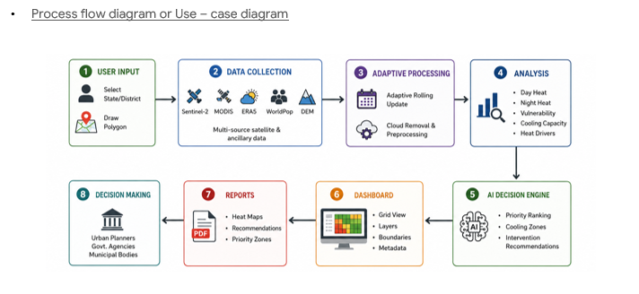
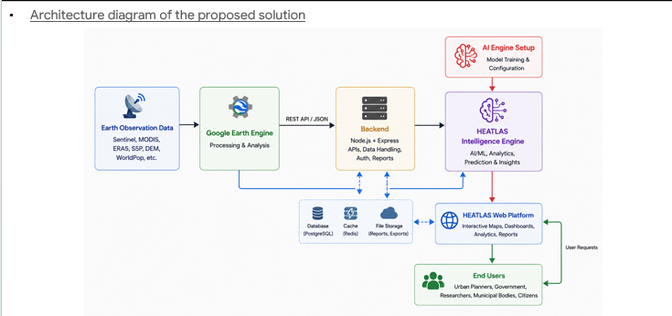

# HEATLAS — Workflow and Proposed System Architecture

This page presents two diagrams from the **Bharatiya Antariksh Hackathon 2026** submission: the proposed process workflow and the proposed system architecture. Together, they show how HEATLAS was designed to move from satellite observations to spatial heat analysis and, ultimately, decision support for urban cooling interventions.

The design uses **Jaipur District as the pilot** and is intended to be extendable from district-level analysis to state-level and, eventually, national-level coverage. The diagrams describe the intended structure and direction of the project; they should not be read as evidence that every component has been completed or integrated.

## 1. Proposed process workflow

The workflow is organised into eight connected stages:

1. **User input:** Select a state or district and, in the proposed interface, optionally define a custom polygon for analysis.
2. **Data collection:** Bring together Earth-observation and supporting datasets. The submitted diagram names Sentinel-2, MODIS, ERA5, WorldPop and DEM; the GEE script also uses additional sources described in the [GEE documentation](../../GEE/README.md).
3. **Adaptive processing:** Prepare and filter incoming observations, including cloud-related preprocessing, so they can be used for analysis. The current script contains Sentinel-2 cloud filtering/masking and defined data windows, but a fully adaptive, synchronised update system across all sources is not yet implemented.
4. **Analysis:** Derive daytime and nighttime heat information and assess heat drivers, cooling capacity and vulnerability. The GEE work contains substantial parts of this analytical stage; some outputs and aggregation details still require validation and correction.
5. **AI decision engine:** The proposed next stage is to rank priority areas, identify cooling zones and recommend interventions. The current GEE script contains four rule-based mitigation-suitability masks; a trained AI/ML ranking and recommendation engine has not been implemented.
6. **Dashboard:** Present the spatial grid, analytical layers, boundaries and related metadata through an interactive interface. The dashboard shown in the proposal is a design concept, not a completed frontend.
7. **Reports:** Provide heat maps, recommendations and priority-area summaries to support planning. Automated report generation remains proposed work.
8. **Decision-making:** Make the analysis useful to urban planners, government agencies and municipal bodies when prioritising local cooling measures.

## 2. Proposed system architecture

The architecture diagram describes how the major technical components are intended to communicate:

- **Earth-observation data → Google Earth Engine:** Satellite and supporting datasets enter GEE for geospatial processing, layer generation and heat analysis.
- **GEE → Backend:** The diagram proposes a REST API / JSON connection to a Node.js and Express backend. The backend is intended to manage requests, data handling, authentication and report-related services.
- **Backend ↔ Intelligence Engine:** A separate HEATLAS Intelligence Engine is proposed for AI/ML analytics, prediction and insights. The AI Engine Setup block represents the planned model-training and configuration pathway.
- **Storage services:** The diagram includes a database, cache and file storage to support data, metadata and generated reports. These are architectural proposals; the final storage choices are not yet settled.
- **Web platform ↔ End users:** The proposed web platform presents interactive maps, dashboards, analytics and reports. Users submit requests through the interface and receive the corresponding outputs.

## 3. How the design supports wider-scale analysis

The workflow and architecture are intended to support a progression from the **Jaipur District pilot** to additional districts, state-level analysis and broader national coverage. The spatial selection, data-processing and presentation components are separated conceptually so that the study geography and amount of data can be expanded without changing the overall purpose of the system.

This is a **scalability direction, not a completed national deployment**. The current GEE implementation is centred on Jaipur District. State-wide and national data coverage, a user-driven geography-selection interface, automated multi-source updating, a connected backend, the AI/ML engine and the web dashboard remain future development work.

## 4. Current implementation status

- **Implemented in code:** The Jaipur-focused GEE workflow, 1 km grid generation, multi-source geospatial processing, heat-related indices and four rule-based mitigation-suitability layers.
- **Partially developed:** A Node.js / Express backend prototype exists, but its routes are placeholders and it is not connected to the main GEE v3 analysis.
- **Proposed / not yet implemented:** End-to-end API integration, the AI/ML decision engine, interactive frontend, automated reporting and state/national-scale deployment.

*Source: HEATLAS Bharatiya Antariksh Hackathon 2026 presentation — slide 6 (Process Flow) and slide 8 (Proposed System Architecture).*
